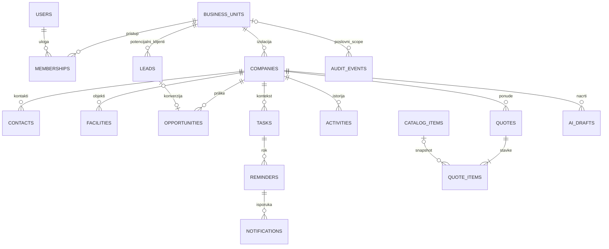

# PostgreSQL plan za postojeći CRM

Datum: 14. oktobar 2026. Osnova: `15d52a32fcd6bb8cef9f935e3c1ab7eee8585a8f`. Nalazi: [CRM_AUDIT.md](CRM_AUDIT.md).

**Status: predlog, bez implementacije i bez izvršenih poslovnih migracija.** Model proširuje postojeći React/FastAPI/SQLAlchemy/PostgreSQL sistem. Čuva postojeći dizajn, navigaciju, tri brenda, identifikatore, API ponašanje i poslovne podatke. Ne uvodi plaćene servise.

## Postojeća osnova i pravila

Već postoje `business_units`, `users`, `memberships`, `login_sessions`, `login_attempts`, `companies`, `contacts`, `opportunities`, `opportunity_stage_changes`, `ai_drafts`, `ai_attempts`. Migracioni head je `a162bced9031`. Tabele u ovom dokumentu označene kao nove još ne postoje.

- LUU, INVEKTA i CENOBOTS su poslovne jedinice u jednoj bazi. Kod je stabilan, naziv i vizuelni identitet ostaju postojeći. Nema tri kopije aplikacije ili baze.
- Svaka poslovna tabela nosi obavezni `business_unit_id`. Globalni identiteti i sesije ostaju globalni. Jedinica iz URL-a nije dokaz prava.
- Postojeći integer PK se čuvaju. Novi visokofrekventni događaji mogu koristiti bigint identity; FK tip mora odgovarati roditelju. Ne uvoditi UUID konverziju postojećih zapisa.
- Novac je `NUMERIC`, ne floating point. Postojeći iznos prilike ostaje `NUMERIC(14,2)` u RSD; budući iznosi dobijaju eksplicitnu valutu. Nema sabiranja različitih valuta bez odobrenog kursnog modela.
- Vreme: `timestamptz`, skladištenje UTC, prikaz `Europe/Belgrade` ili kasnije korisnička zona. Datum očekivanog zaključenja ostaje `DATE`.
- Poslovni zapisi se arhiviraju, ne brišu kaskadno. Članstvo se onemogućava umesto brisanja zbog istorije i postojećih FK.
- Mutacije imaju `version`, `created_at`, `updated_at`; update sa zastarelom verzijom vraća 409. Činjenice iz istorije se ne prepisuju.
- Ne uvoziti izmišljene demo podatke/localStorage automatski. `is_demo` ostaje dok se odvojeno ne odobri politika čišćenja.

## Identiteti, uloge i pristup

| Tabela | Plan |
|---|---|
| `business_units` — postojeća | Zadržati id/code/name; opciono dodati aktivnost i podatke izdavaoca ponude, bez promene kodova |
| `users` — postojeća | Zadržati username, nullable email, hash, aktivnost, globalni admin i verziju; proveriti kolizije pre jedinstvenog indeksa na normalizovani email; bez prećutnog popunjavanja legacy emaila |
| `memberships` — postojeća | PK `(user_id, business_unit_id)`, role `sales/manager/admin`, enabled; ostaje glavni izvor pristupa jedinici |
| Sesije/pokušaji — postojeće | Zadržati hash tokena i server-side opoziv; ne uvoditi token u localStorage; odvojeno ojačati ograničenja prijave |

| Operacija | sales | manager | admin jedinice | globalni platform admin |
|---|---|---|---|---|
| Poslovni zapisi | Sopstvene kompanije i povezani zapisi | Sve u dozvoljenoj jedinici | Sve u dozvoljenoj jedinici | Prema sopstvenom članstvu, bez automatskog bypass-a |
| Sopstveni nacrti | Da, uz vidljivu kompaniju | Da | Da | Prema članstvu |
| Dodela zadatka/prenos vlasništva | Sopstveni zadatak; prenos nije automatski dozvoljen | Ovlašćeni članovi jedinice | Ovlašćeni članovi jedinice | Prema članstvu i eksplicitnom pravilu |
| Globalni korisnici i članstva | Ne | Ne | Ne | Da, kao sada |
| Audit | Sopstveni vidljivi poslovni kontekst | Poslovna jedinica | Poslovna jedinica | Globalna administracija; poslovni audit prema članstvu |

Ovo čuva postojeće razlikovanje unit admin i platform admin. Ako kasnije treba da unit admin dodeljuje pristup, to je zasebno odobrena promena prava, sa ograničenjem na svoju jedinicu. U početku zadržati tri uloge; tabela prilagodljivih uloga nije potrebna. Backend koristi centralne funkcije pristupa i iste politike za liste, detalje, agregate i povezane zapise.

Dodeljeni korisnik zadatka mora biti aktivan i imati omogućeno članstvo i pristup konkretnom kontekstu. Zadatak ne sme otvoriti kompaniju drugog prodavca. Isto važi za buduće notifikacije, izvoz i audit čitanje.

## Kompanije, kontakti i objekti

| Tabela | Predložena polja i ograničenja |
|---|---|
| `companies` — proširenje | Postojeća polja; dodati version/updated_at/archived_at, opciono PIB, matični broj, adresa, website. Vlasnik ostaje FK `(owner_id, business_unit_id)` ka memberships. Poslovni identifikator proveravati pre novih unique ograničenja |
| `contacts` — proširenje | Zadržati company/unit/name/position/email/phone; dodati version/updated_at/archived_at i `UNIQUE(id, business_unit_id)` radi novih složenih FK. Email nije univerzalno jedinstven kontakt |
| `facilities` — nova | id, unit, company, name, adresa/grad, vrsta objekta, optional timezone, version, timestamps, archived_at; composite FK ka kompaniji |
| `contact_facilities` — nova | Veza kontakta i objekta, role/primary opcionalno; isti unit i ista kompanija obavezni |

Kompanija je pravni/poslovni klijent; objekat je konkretna lokacija. Proizvodi, usluge i prilike nisu kopije kompanije po lokaciji. Kontakt može pripadati više objekata iste kompanije. Za tu vezu dodati `UNIQUE(id, company_id, business_unit_id)` na roditelje i odgovarajuće FK, tako da nije moguće povezati kontakt i objekat dve različite kompanije u istoj jedinici.

Ne uklanjati postojeća `companies.stage/potential_value` u prvoj migraciji. Popisati njihove korisnike i poreklo, pa eventualno odvojeno deprecirati; već postojeće prilike ostaju izvor levka. Company/contact PATCH mora razlikovati izostavljeno polje od eksplicitnog null i proveravati verziju.

## Leadovi i prodajne prilike

`leads` je **nova** tabela za potencijalnog klijenta pre formiranja poslovnog zapisa: id, unit, owner, naziv kompanije/osobe, email/telefon, source, status (`new`, `qualified`, `disqualified`, `converted`), beleške, optional converted_company_id/converted_opportunity_id, converted_at, version, timestamps, archived_at. Svi vlasnici i veze moraju biti iz iste jedinice. Postojeći ekran Novi klijenti trenutno koristi kompanije, a naziv faze Novi lead nije zaseban Lead model.

Izvor može biti ručni unos, preporuka ili odobren import. Opciono `lead_sources` čuva naziv, referentni URL i datum/provenance; ne planirati plaćeno automatsko prikupljanje kao preduslov. Lične podatke unositi samo kada su potrebni.

Konverzija leada je jedna autorizovana, idempotentna transakcija: izabrati postojeću ili kreirati kompaniju, opciono kontakt, kreirati priliku, zapisati veze i audit. Ponovljeni zahtev ne sme kreirati duplikate. Ne konvertovati postojeće kompanije u leadove niti stare demo zapise bez odluke korisnika.

`opportunities` se **proširuje**, ne menja novom tabelom. Zadržati postojeći title/amount/stage/expected_close_date/notes/version i sedam faza. Dodati optional facility_id, lead_id i currency uz RSD za postojeće zapise. Pristup ostaje nasleđen od kompanije; novi vlasnik prilike nije potreban dok se ne odobri nezavisna dodela. Veza objekta mora potvrditi istu kompaniju. `opportunity_stage_changes` ostaje operativna istorija statusa, pored opšteg audita.

## Aktivnosti, zadaci i podsetnici

| Nova tabela | Sadržaj |
|---|---|
| `activities` | id, unit, actor, company_id ili lead_id, optional contact/opportunity/facility, kind (`call`, `meeting`, `note`, `email`), occurred_at, subject, notes, outcome, timestamps/version |
| `tasks` | id, unit, creator, assignee, kontekst, title/description, status (`open`, `doing`, `done`, `cancelled`), priority, due_at ili due_on, completed_at, version, timestamps, archived_at |
| `reminders` | id, unit, task_id, recipient, fire_at, status (`pending`, `delivered`, `cancelled`), delivered_at, idempotency_key, attempts/last_error |
| `notifications` | id, unit, recipient, reminder/task referenca, title, created_at/read_at; minimalan sadržaj, bez kopiranja poverljivih poruka |

Aktivnost beleži šta se dogodilo; zadatak šta treba uraditi. Ručno zabeležen email nije dokaz slanja iz aplikacije. Primarni kontekst aktivnosti/zadatka je tačno jedna kompanija ili lead (`CHECK`); optional contact/opportunity/facility traži kompanijski kontekst i FK koji potvrđuje istu kompaniju/jedinicu. Izbegavati neproverljiv generički `entity_type/entity_id` za poslovne veze.

Rok može biti datum bez vremena ili tačno vreme, sa ograničenjem koje sprečava konflikt oba polja. Podsetnik uvek ima tačno vreme; aplikacija ne izmišlja sat za datum bez korisničkog izbora. Završavanje zadatka otkazuje pending podsetnike u istoj transakciji.

Za početak koristiti in-app obaveštenja i mali postojeći Python worker sa PostgreSQL `FOR UPDATE SKIP LOCKED`, ponavljanjem i unique idempotency ključem. Redis/Celery/plaćeni email servis nisu potrebni. Pre isporuke ponovo proveriti aktivnog korisnika i njegov pristup, da opozvano članstvo ne dobije podatke. Worker dobija posebnu ograničenu ulogu, bez superuser prava.

## Ponude, proizvodi i usluge

| Nova tabela | Sadržaj |
|---|---|
| `catalog_items` | id, unit, kind (`product`, `service`), sku, name, description, unit_of_measure, default_price, currency, vat_rate, active, version/timestamps; unique(unit, sku) |
| `quotes` | id, unit, company, optional opportunity/facility, number, revision, status (`draft`, `sent`, `accepted`, `rejected`, `expired`), issued_on, valid_until, currency, seller/customer snapshot, totals, creator, version/timestamps |
| `quote_items` | id, unit, quote_id, line_number, optional catalog_item_id, snapshot naziva/opisa/jedinice, quantity, unit_price, discount, vat_rate, line totals |

Katalog je zajednički tip modula za sve tri firme sa odvojenim podacima, ne povratak ranije uklonjenih specijalizovanih menija. Nema magacina, faktura ili ugovora bez posebnog zahteva.

`UNIQUE(unit, number, revision)` za ponude, `UNIQUE(quote_id, line_number)` za stavke. Numeraciju rezervisati transakciono po jedinici (counter red pod lock-om), ne `max+1` bez zaključavanja. Katalog može biti nullable na stavci za ručni proizvod/uslugu, ali snapshot je obavezan. Promena cenovnika ne menja poslatu ponudu. Prihvaćena/poslata verzija je nepromenljiv snapshot; revizija kreira novu verziju i vezu prethodnika.

Backend računa iznose sa Decimal, eksplicitnim zaokruživanjem i dogovorenim pravilima PDV/popusta. Količina mora biti pozitivna, cene nenegativne, valid_until ne pre issued_on. Frontend izračun nije izvor istine. Oznaka sent bez integracije predstavlja ručno potvrđenu isporuku; ne simulirati automatsko slanje.

## Nacrti i evidencija promena

Zadržati `ai_drafts`, autor/jedinica/kompanija ostaju obavezni, a čitanje nacrta ograničeno na autora. Opciono dodati contact_id/opportunity_id uz potvrdu istog kompanijskog konteksta i minimalni kontekst šablona. Ne čuvati nepotrebno kompletnu dolaznu korespondenciju. Lokalni besplatni šabloni ostaju podrazumevani; proširenje baze ne aktivira komercijalni AI.

Nova `audit_events`: bigint id, scope (`unit` ili `platform`), nullable unit, actor_user_id, action, entity_type, entity_id, changed_fields JSONB, occurred_at, request_id. CHECK zahteva unit za poslovni scope, a null za globalni administratorski scope. Identifikator objekta u auditu može biti generički jer istorija mora preživeti arhiviranje, dok operativni poslovni odnosi koriste stvarne FK.

Audit upis ide u istoj transakciji kao promena. Beleži kreiranje/izmenu/arhiviranje, prenos vlasnika, konverziju leada i promenu članstva/aktivnosti naloga. Ne beležiti hash/lozinke/tokene, tajne konfiguracije ili kompletne email poruke. Zabeležiti promenjena polja uz redakciju. Normalna aplikaciona uloga nema UPDATE/DELETE nad auditom; čitanje je posebno autorizovano. Globalni administratorski događaji dostupni su samo platform admin-u; unit audit ne otkriva tuđe nevidljive kompanije prodavcu.

## Izolacija na nivou baze i backend-a

Postojeći složeni FK su dobra osnova, ali RLS trenutno ne postoji. Svaka nova tabela dobija zaseban FK unit i složene FK `(entity_id, business_unit_id)`; za usaglašenost kompanije koristiti i `(id, company_id, business_unit_id)`. Nullable veza ne sme omogućiti zapis bez poslovne jedinice.

Preporučeni redosled zaštite:

1. Backend najpre proverava aktivnu sesiju, enabled članstvo, ulogu i vlasništvo; ista pravila važe za sve CRUD, agregate i worker događaje.
2. Odvojiti migration owner od runtime korisnika. Runtime nije superuser, nema BYPASSRLS, ne poseduje tabele i ima samo potrebne privilegije; test runner koristi zasebne razvojne kredencijale.
3. Posle regresionih testova uvoditi RLS po modulu. Transakcijski kontekst actor/unit postavlja se parametrizovanim `set_config(..., true)` / SET LOCAL, ne string interpolacijom.
4. Politike koriste verifikovano članstvo i vlasništvo; `USING` i `WITH CHECK` štite čitanje i upis. Odsutan/nevalidan kontekst podrazumevano odbija pristup. Ako članstva sama imaju RLS, pažljivo izbeći rekurzivne policy funkcije i testirati privilegije.
5. Kontekst mora ponovo biti postavljen nakon svakog commit-a/nove transakcije; postojeće rezervisanje nacrta koristi više transakcija. Ne postavljati ga samo jednom po HTTP zahtevu niti trajno na pooled konekciji.
6. Uvesti testove na neprivilegovanoj runtime ulozi; superuser testovi ne dokazuju RLS. Servisni worker dobija ograničen eksplicitan kontekst, ne globalni bypass.

RLS je dodatna zaštita od propuštenog SQL scope-a, ne zamena za poslovnu autorizaciju. PostgreSQL shared schema sa ovim pravilima je najmanje rizičan model u odnosu na tri odvojena sistema. Ne uvoditi schema-per-tenant ili novi auth servis tokom ovog prelaska.

## Indeksi i očuvanje podataka

Sačuvati postojeće indekse i dodavati prema stvarnim upitima:

- companies(unit, owner), contacts(unit, company); provereni poslovni identitet po jedinici, ne blanket globalna jedinstvenost.
- leads(unit, owner, status), opportunities(unit, stage), activities(unit, company, occurred_at).
- tasks(unit, assignee, status, due_at/due_on), partial index aktivnih zadataka ako plan upita opravda.
- reminders(fire_at) WHERE status='pending'; notifications(unit, recipient, read_at).
- quotes(unit, number, revision), quote_items(quote_id, line_number), catalog_items(unit, sku).
- audit_events(unit, occurred_at), (entity_type, entity_id, occurred_at); vremenska politika zadržavanja tek nakon odluke korisnika.

Sve promene su Alembic migracije. Pre novih unique/FK pravila izvesti read-only preflight duplikata, orphan veza i nullable vrednosti. Dodavati nullable polja, kontrolisano backfill, zatim ograničenja; ne prepisivati poslovne vrednosti pretpostavkama. Pre write migracije obavezna proverena rezervna kopija i plan povratka. Ne oslanjati se na destruktivni downgrade za spas podataka.

## Relacije — sažet prikaz

Postojeće: jedinice, korisnici/članstva, kompanije, kontakti, prilike, nacrti. Ostale poslovne tabele u dijagramu su predložene.

Dijagram je konceptualan: zadatak/aktivnost mogu imati lead umesto kompanije, ponuda u draft-u može privremeno nemati stavke; tačna ograničenja su opisana iznad. Tenant i actor FK važe i gde su izostavljeni radi preglednosti.

## Povezivanje i faze implementacije

Frontend je **već povezan** sa FastAPI. Nastaviti postojeći `lib/api.ts`, `Workspace`, zajednički Shell i modularne feature komponente. Dodavati tipizovane pozive i postojeće FastAPI routere, SQLAlchemy modele, Pydantic šeme i Alembic migracije. React demo ostaje jasno označen; API greška ne sme tiho prebaciti korisnika na izmišljene podatke.

| Korak posle odobrenja | Rezultat / provera |
|---|---|
| 1. Bez izmene poslovne šeme | Reproduktivni Codespaces/CI setup, izolovani PostgreSQL testovi, smoke prijava/logout, sva tri članstva, negativni cross-unit/owner testovi, dogovoreni lint |
| 2. Bezbedna višekorisnička osnova | Company/contact version i dosledan PATCH, audit i kontrolisani prenos vlasništva; tests za konkurenciju, opoziv pristupa i istoriju |
| 3. Prvi funkcionalni modul | Tasks/activities i in-app podsetnici; povezati postojeći ekran Zadaci i dobrodošlicu sa stvarnim dnevnim obavezama |
| 4. Podaci o prodaji | Objekti, zasebni leadovi i idempotentna konverzija, bez automatskog import-a demo baze |
| 5. Ponude | Katalog, quote snapshot/revizije, server-side totals; postojeća navigacija Ponude |
| 6. Operativna zaštita | RLS po modulu na runtime ulozi, backup/restore proba, pagination, produkcioni TLS/proxy plan; deployment samo uz odvojenu autorizaciju |

Pre svakog koraka: konkretan plan migracije, testovi prava i očuvanja prethodnog ponašanja, pregled promene. Ne uvoditi sve tabele u jednom zahvatu. Prvi korak je infrastruktura provere, ne kompletna baza.

Za razvoj ostaju besplatni open-source alati i lokalni Docker PostgreSQL u Codespaces-u. Dodavanje `.devcontainer`/CI je budući odobreni korak. GitHub Codespaces je besplatan samo u raspoloživoj kvoti naloga, ne neograničeno besplatno hosting rešenje. Ne uvoditi Supabase/Auth0/komercijalni AI ili plaćeni email servis kao uslov rada.

Setup mora očuvati postojeći `.env` i volumen, ne ispisivati tajne i ne seed-ovati bazu pri svakom pokretanju. Razvoj koristi Vite proxy; kasnije produkciono serviranje mora imati isti origin za frontend/API, HTTPS i Secure cookie. Vite preview nije produkciona backend konfiguracija.

## Odluke koje ostaju za implementacioni plan

Nakon odobrenja potvrditi pravila numeracije ponuda, PDV/zaokruživanja, datumskih rokova, zadržavanja audita i prava na prenos vlasništva. Te odluke ne blokiraju sadašnju reviziju, ali se ne smeju nagađati pri upisu poslovnih podataka. Nema aktivirane nove usluge, plaćenog API-ja, poslovnog backfill-a ili produkcionog deployment-a u ovoj fazi.
